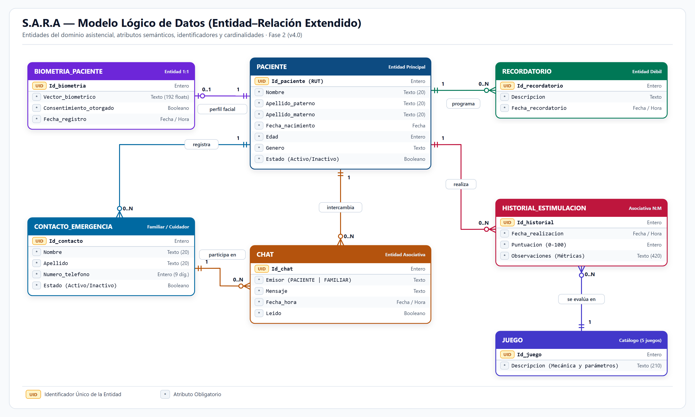
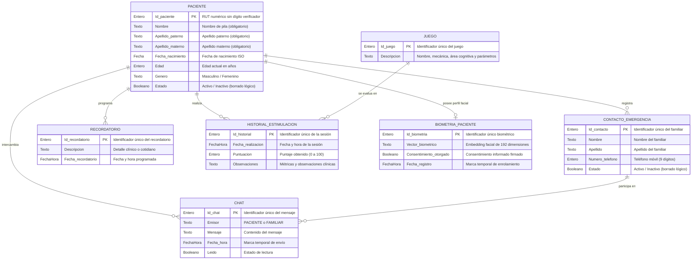

# Modelo Lógico de Datos — S.A.R.A

**Proyecto:** S.A.R.A — Sistema Asistente Robótico de Apoyo para Adultos Mayores  
**Versión de Esquema:** 4.0 (Fase 2)  
**Nivel de Abstracción:** Modelo Lógico (Entidad–Relación Extendido, independiente del motor físico)

---

## 1. Propósito del Modelo Lógico

El modelo lógico describe las entidades del dominio asistencial de S.A.R.A, sus atributos semánticos, identificadores únicos, reglas de negocio y relaciones con sus cardinalidades, abstrayéndose de detalles de almacenamiento propios de SQLite o Android Room.

---

## 2. Diagrama del Modelo Lógico

### 2.1 Gráfico del Modelo Lógico (PNG / SVG)

> También disponible en formato vectorial escalable: [modelo_logico.svg](./diagramas/modelo_logico.svg).

### 2.2 Diagrama Entidad–Relación (Mermaid)

---

## 3. Definición Lógica de Entidades

### 3.1 `PACIENTE`
Representa al adulto mayor beneficiario de S.A.R.A. Es la entidad raíz del modelo alrededor de la cual orbitan el acompañamiento cognitivo, los recordatorios, la comunicación familiar y el reconocimiento biométrico.
* **Identificador Único (UID):** `Id_paciente` (RUT numérico asignado manualmente, sin dígito verificador).
* **Atributos obligatorios:** `Nombre`, `Apellido_paterno`, `Apellido_materno`, `Fecha_nacimiento`, `Edad`, `Genero`, `Estado`.

### 3.2 `CONTACTO_EMERGENCIA` (Familiar / Cuidador)
Representa a un familiar o cuidador responsable asociado a un paciente para emergencias y comunicación por chat privado.
* **Identificador Único (UID):** `Id_contacto` (generado automáticamente).
* **Atributos obligatorios:** `Nombre`, `Apellido`, `Numero_telefono`, `Estado`.

### 3.3 `RECORDATORIO`
Representa una alerta programada para un paciente (toma de medicamentos, controles médicos, hidratación, terapias o sesiones con S.A.R.A).
* **Identificador Único (UID):** `Id_recordatorio` (generado automáticamente).
* **Atributos obligatorios:** `Descripcion`, `Fecha_recordatorio`.

### 3.4 `JUEGO`
Catálogo maestro de actividades lúdicas de estimulación cognitiva ejecutadas por S.A.R.A.
* **Identificador Único (UID):** `Id_juego` (generado automáticamente).
* **Atributos obligatorios:** `Descripcion`.
* **Instancias definidas en el dominio (5 juegos):**
  1. **Trivia de Época (Música, Cine e Historia):** Memoria remota y semántica (`% aciertos`, `tiempo de respuesta`).
  2. **¿Quién soy? (Adivinanza por Pistas):** Razonamiento deductivo y acceso al léxico (`pistas usadas: 3/2/1 pts`, `fallos`).
  3. **Mito o Realidad (Verdadero / Falso):** Velocidad de procesamiento, atención y juicio lógico (`aciertos totales`, `racha máxima`, `latencia`).
  4. **Termina la Canción:** Memoria auditiva, lenguaje y atención sostenida (`frases completadas`, `ayudas solicitadas`, `fluidez`).
  5. **¿Qué Pasó Primero?:** Orientación temporal y función ejecutiva (`aciertos sobre rondas`, `tiempo de deliberación`).

### 3.5 `HISTORIAL_ESTIMULACION` *(Entidad Asociativa)*
Resuelve la relación muchos-a-muchos (**N:M**) entre `PACIENTE` y `JUEGO`, permitiendo que un paciente juegue múltiples veces un mismo juego o distintos juegos a lo largo del tiempo, conservando el registro histórico de desempeño cognitivo.
* **Identificador Único (UID):** `Id_historial` (generado automáticamente).
* **Atributos obligatorios:** `Fecha_realizacion`, `Puntuacion`, `Observaciones`.

### 3.6 `CHAT` *(Entidad Asociativa de Mensajería)*
Registra los mensajes privados intercambiados entre un paciente (mediante dictado de voz en S.A.R.A) y un familiar específico (desde la vista de texto plano de Familiar).
* **Identificador Único (UID):** `Id_chat` (generado automáticamente).
* **Atributos obligatorios:** `Emisor` (`PACIENTE` | `FAMILIAR`), `Mensaje`, `Fecha_hora`, `Leido`.

### 3.7 `BIOMETRIA_PACIENTE`
Almacena el perfil biométrico facial (embedding de 192 valores flotantes generado por MobileFaceNet) junto con el registro auditable de consentimiento informado.
* **Identificador Único (UID):** `Id_biometria` (generado automáticamente) + restricción de unicidad sobre el paciente asociado.
* **Atributos obligatorios:** `Vector_biometrico`, `Consentimiento_otorgado`, `Fecha_registro`.

---

## 4. Matriz de Relaciones y Cardinalidades

| Relación | Entidad Origen | Cardinalidad | Entidad Destino | Tipo / Semántica |
| :--- | :--- | :---: | :--- | :--- |
| Registra familiar | `PACIENTE` | **1 : 0..N** | `CONTACTO_EMERGENCIA` | Un paciente puede tener uno o más contactos de emergencia; cada contacto pertenece a exactamente un paciente. |
| Programa alerta | `PACIENTE` | **1 : 0..N** | `RECORDATORIO` | Un paciente puede tener cero o múltiples recordatorios; cada recordatorio pertenece a un único paciente. |
| Ejecuta sesión | `PACIENTE` | **1 : 0..N** | `HISTORIAL_ESTIMULACION` | Un paciente puede acumular múltiples sesiones de estimulación; cada sesión pertenece a un paciente. |
| Evalúa actividad | `JUEGO` | **1 : 0..N** | `HISTORIAL_ESTIMULACION` | Un juego puede jugarse múltiples veces; cada sesión del historial corresponde a un único juego. |
| Envía / Recibe chat | `PACIENTE` | **1 : 0..N** | `CHAT` | Un paciente participa en cero o muchos mensajes de chat privado. |
| Participa en chat | `CONTACTO_EMERGENCIA` | **1 : 0..N** | `CHAT` | Cada mensaje de chat involucra exactamente a un familiar/contacto de emergencia del paciente. |
| Enrolamiento facial | `PACIENTE` | **1 : 0..1** | `BIOMETRIA_PACIENTE` | Relación estricta **1:1 opcional**: un paciente puede tener a lo sumo un perfil biométrico activo; todo perfil biométrico pertenece a un único paciente. |

---

## 5. Reglas de Negocio Clave

1. **Eliminación Lógica en Entidades Maestras:** Ni los `PACIENTE` ni sus `CONTACTO_EMERGENCIA` se eliminan físicamente desde la interfaz administrativa; su atributo `Estado` cambia a `Inactivo` (`false`) para preservar la trazabilidad clínica, excluyéndolos de búsquedas activas, telemetría e informes.
2. **Privacidad y Consentimiento Biométrico:** Solo se almacena el vector numérico (embedding de 192 dimensiones) y la confirmación de `Consentimiento_otorgado`, nunca fotografías crudas en la base de datos.
3. **Aislamiento del Chat Familiar:** El emisor de un mensaje de `CHAT` solo puede tomar los valores `PACIENTE` o `FAMILIAR`. Los mensajes del familiar ingresan con `Leido = false` hasta que S.A.R.A los lee en voz alta al paciente.
4. **Métricas Cognitivas Trazables:** Toda sesión registrada en `HISTORIAL_ESTIMULACION` debe asociarse a un paciente válido y a uno de los juegos del catálogo, consignando puntaje y observaciones estructuradas según los parámetros propios del juego.
5. **Integridad ante Borrado Físico:** En caso de depuración física a nivel de motor de datos, la eliminación de un `PACIENTE` o `JUEGO` propaga la eliminación en cascada a sus registros dependientes para evitar registros huérfanos.
