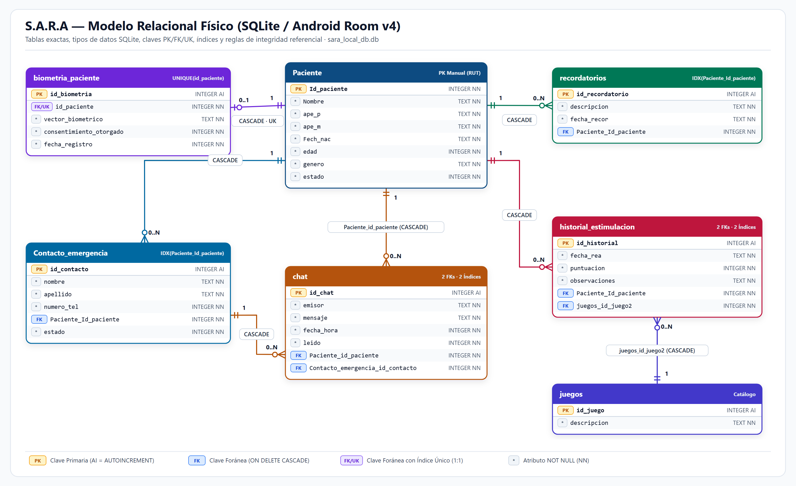
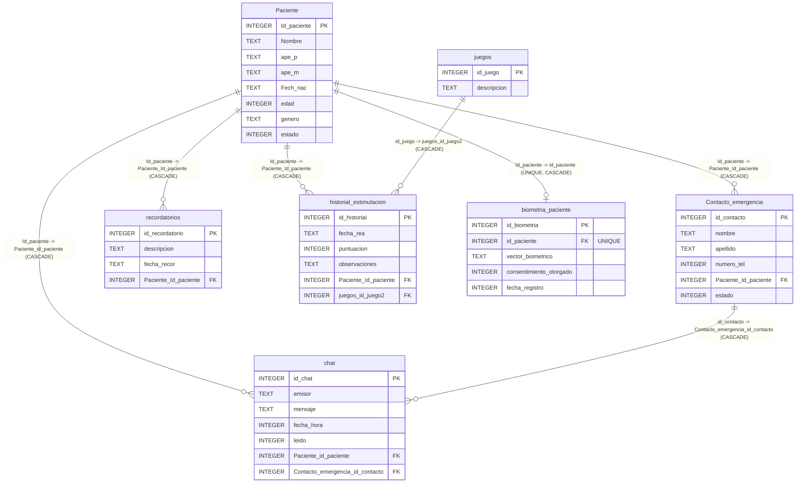

# Modelo Relacional — S.A.R.A (Room v4 / SQLite)

**Proyecto:** S.A.R.A — Sistema Asistente Robótico de Apoyo para Adultos Mayores  
**SGBD:** SQLite 3 (Android Jetpack Room `2.6.1`, `version = 4`)  
**Archivo Físico:** `Fase 2/Interfaz Usuario SARA/android/sara_local_db.db`  
**Identity Hash Room:** `c156ccccc4ec2172821d7fb19d0ba657`

---

## 1. Diagrama del Modelo Relacional

### 1.1 Gráfico del Modelo Relacional (PNG / SVG)



> También disponible en formato vectorial escalable: [modelo_relacional.svg](./diagramas/modelo_relacional.svg).

### 1.2 Diagrama Relacional (Mermaid)



---

## 2. Notación Relacional Estándar

Convención utilizada: **<u>PK</u>** = Clave Primaria, *`FK`* = Clave Foránea, **`[UK]`** = Restricción Única.

1. **`Paciente`** (<u>`Id_paciente`</u>, `Nombre`, `ape_p`, `ape_m`, `Fech_nac`, `edad`, `genero`, `estado`)
2. **`Contacto_emergencia`** (<u>`id_contacto`</u>, `nombre`, `apellido`, `numero_tel`, *`Paciente_Id_paciente`*, `estado`)
   * *`Paciente_Id_paciente`* → `Paciente`(`Id_paciente`) `[ON DELETE CASCADE]`
3. **`recordatorios`** (<u>`id_recordatorio`</u>, `descripcion`, `fecha_recor`, *`Paciente_Id_paciente`*)
   * *`Paciente_Id_paciente`* → `Paciente`(`Id_paciente`) `[ON DELETE CASCADE]`
4. **`juegos`** (<u>`id_juego`</u>, `descripcion`)
5. **`historial_estimulacion`** (<u>`id_historial`</u>, `fecha_rea`, `puntuacion`, `observaciones`, *`Paciente_Id_paciente`*, *`juegos_id_juego2`*)
   * *`Paciente_Id_paciente`* → `Paciente`(`Id_paciente`) `[ON DELETE CASCADE]`
   * *`juegos_id_juego2`* → `juegos`(`id_juego`) `[ON DELETE CASCADE]`
6. **`chat`** (<u>`id_chat`</u>, `emisor`, `mensaje`, `fecha_hora`, `leido`, *`Paciente_id_paciente`*, *`Contacto_emergencia_id_contacto`*)
   * *`Paciente_id_paciente`* → `Paciente`(`Id_paciente`) `[ON DELETE CASCADE]`
   * *`Contacto_emergencia_id_contacto`* → `Contacto_emergencia`(`id_contacto`) `[ON DELETE CASCADE]`
7. **`biometria_paciente`** (<u>`id_biometria`</u>, *`id_paciente`* **`[UK]`**, `vector_biometrico`, `consentimiento_otorgado`, `fecha_registro`)
   * *`id_paciente`* → `Paciente`(`Id_paciente`) `[ON DELETE CASCADE]`

---

## 3. Catálogo de Claves e Índices

### 3.1 Claves Foráneas e Integridad Referencial

| Tabla hija | Columna FK | Tabla padre | Columna referenciada | `ON UPDATE` | `ON DELETE` |
| :--- | :--- | :--- | :--- | :---: | :---: |
| `Contacto_emergencia` | `Paciente_Id_paciente` | `Paciente` | `Id_paciente` | `NO ACTION` | `CASCADE` |
| `recordatorios` | `Paciente_Id_paciente` | `Paciente` | `Id_paciente` | `NO ACTION` | `CASCADE` |
| `historial_estimulacion` | `Paciente_Id_paciente` | `Paciente` | `Id_paciente` | `NO ACTION` | `CASCADE` |
| `historial_estimulacion` | `juegos_id_juego2` | `juegos` | `id_juego` | `NO ACTION` | `CASCADE` |
| `chat` | `Paciente_id_paciente` | `Paciente` | `Id_paciente` | `NO ACTION` | `CASCADE` |
| `chat` | `Contacto_emergencia_id_contacto` | `Contacto_emergencia` | `id_contacto` | `NO ACTION` | `CASCADE` |
| `biometria_paciente` | `id_paciente` | `Paciente` | `Id_paciente` | `NO ACTION` | `CASCADE` |

### 3.2 Índices Físicos Definidos

| Nombre del índice | Tabla | Columna(s) | Tipo | Propósito |
| :--- | :--- | :--- | :---: | :--- |
| `index_Contacto_emergencia_Paciente_Id_paciente` | `Contacto_emergencia` | `Paciente_Id_paciente` | Non-Unique | Acelerar consultas de familiares por paciente y evitar full scan en `CASCADE`. |
| `index_recordatorios_Paciente_Id_paciente` | `recordatorios` | `Paciente_Id_paciente` | Non-Unique | Acelerar carga de recordatorios por paciente. |
| `index_historial_estimulacion_Paciente_Id_paciente` | `historial_estimulacion` | `Paciente_Id_paciente` | Non-Unique | Acelerar historial cognitivo por paciente. |
| `index_historial_estimulacion_juegos_id_juego2` | `historial_estimulacion` | `juegos_id_juego2` | Non-Unique | Acelerar reportes y estadísticas agrupadas por juego. |
| `index_chat_Paciente_id_paciente` | `chat` | `Paciente_id_paciente` | Non-Unique | Acelerar consulta de mensajes por paciente. |
| `index_chat_Contacto_emergencia_id_contacto` | `chat` | `Contacto_emergencia_id_contacto` | Non-Unique | Acelerar carga de hilos de conversación por familiar. |
| `index_biometria_paciente_id_paciente` | `biometria_paciente` | `id_paciente` | **UNIQUE** | Garantizar físicamente la cardinalidad estricta **1:1** entre paciente y perfil biométrico. |

---

## 4. Análisis de Normalización

| Forma Normal | Estado | Sustento Técnico |
| :---: | :---: | :--- |
| **1FN** (Primera Forma Normal) | Cumplida *(con excepción controlada)* | Todas las tablas poseen clave primaria única y columnas atómicas (`Nombre`, `ape_p`, `ape_m` separados). Como decisión deliberada de rendimiento en dispositivos móviles, `biometria_paciente.vector_biometrico` serializa los 192 floats del embedding facial como CSV para lectura directa por MobileFaceNet sin joins costosos. |
| **2FN** (Segunda Forma Normal) | Cumplida | Todas las tablas tienen clave primaria simple (de un solo atributo), eliminando cualquier dependencia funcional parcial. La relación N:M entre `Paciente` y `juegos` se descompone en la tabla puente `historial_estimulacion`. |
| **3FN** (Tercera Forma Normal) | Cumplida *(con desnormalización controlada)* | No existen dependencias transitivas entre atributos de entidades distintas. En `Paciente`, el atributo `edad` es derivable de `Fech_nac`, pero se persiste intencionalmente para simplificar filtros y despliegue inmediato en fichas clínicas del panel administrativo. |

---

## 5. Script DDL Físico (SQLite — Room v4)

Extraído directamente de la implementación generada por Room KSP (`SaraAppDatabase_Impl.java`):

```sql
PRAGMA foreign_keys = ON;
PRAGMA user_version = 4;

CREATE TABLE IF NOT EXISTS `Paciente` (
    `Id_paciente` INTEGER NOT NULL,
    `Nombre` TEXT NOT NULL,
    `ape_p` TEXT NOT NULL,
    `ape_m` TEXT NOT NULL,
    `Fech_nac` TEXT NOT NULL,
    `edad` INTEGER NOT NULL,
    `genero` TEXT NOT NULL,
    `estado` INTEGER NOT NULL,
    PRIMARY KEY(`Id_paciente`)
);

CREATE TABLE IF NOT EXISTS `recordatorios` (
    `id_recordatorio` INTEGER PRIMARY KEY AUTOINCREMENT NOT NULL,
    `descripcion` TEXT NOT NULL,
    `fecha_recor` TEXT NOT NULL,
    `Paciente_Id_paciente` INTEGER NOT NULL,
    FOREIGN KEY(`Paciente_Id_paciente`) REFERENCES `Paciente`(`Id_paciente`)
        ON UPDATE NO ACTION ON DELETE CASCADE
);
CREATE INDEX IF NOT EXISTS `index_recordatorios_Paciente_Id_paciente`
    ON `recordatorios` (`Paciente_Id_paciente`);

CREATE TABLE IF NOT EXISTS `Contacto_emergencia` (
    `id_contacto` INTEGER PRIMARY KEY AUTOINCREMENT NOT NULL,
    `nombre` TEXT NOT NULL,
    `apellido` TEXT NOT NULL,
    `numero_tel` INTEGER NOT NULL,
    `Paciente_Id_paciente` INTEGER NOT NULL,
    `estado` INTEGER NOT NULL,
    FOREIGN KEY(`Paciente_Id_paciente`) REFERENCES `Paciente`(`Id_paciente`)
        ON UPDATE NO ACTION ON DELETE CASCADE
);
CREATE INDEX IF NOT EXISTS `index_Contacto_emergencia_Paciente_Id_paciente`
    ON `Contacto_emergencia` (`Paciente_Id_paciente`);

CREATE TABLE IF NOT EXISTS `juegos` (
    `id_juego` INTEGER PRIMARY KEY AUTOINCREMENT NOT NULL,
    `descripcion` TEXT NOT NULL
);

CREATE TABLE IF NOT EXISTS `historial_estimulacion` (
    `id_historial` INTEGER PRIMARY KEY AUTOINCREMENT NOT NULL,
    `fecha_rea` TEXT NOT NULL,
    `puntuacion` INTEGER NOT NULL,
    `observaciones` TEXT NOT NULL,
    `Paciente_Id_paciente` INTEGER NOT NULL,
    `juegos_id_juego2` INTEGER NOT NULL,
    FOREIGN KEY(`Paciente_Id_paciente`) REFERENCES `Paciente`(`Id_paciente`)
        ON UPDATE NO ACTION ON DELETE CASCADE,
    FOREIGN KEY(`juegos_id_juego2`) REFERENCES `juegos`(`id_juego`)
        ON UPDATE NO ACTION ON DELETE CASCADE
);
CREATE INDEX IF NOT EXISTS `index_historial_estimulacion_Paciente_Id_paciente`
    ON `historial_estimulacion` (`Paciente_Id_paciente`);
CREATE INDEX IF NOT EXISTS `index_historial_estimulacion_juegos_id_juego2`
    ON `historial_estimulacion` (`juegos_id_juego2`);

CREATE TABLE IF NOT EXISTS `chat` (
    `id_chat` INTEGER PRIMARY KEY AUTOINCREMENT NOT NULL,
    `emisor` TEXT NOT NULL,
    `mensaje` TEXT NOT NULL,
    `fecha_hora` INTEGER NOT NULL,
    `leido` INTEGER NOT NULL,
    `Paciente_id_paciente` INTEGER NOT NULL,
    `Contacto_emergencia_id_contacto` INTEGER NOT NULL,
    FOREIGN KEY(`Paciente_id_paciente`) REFERENCES `Paciente`(`Id_paciente`)
        ON UPDATE NO ACTION ON DELETE CASCADE,
    FOREIGN KEY(`Contacto_emergencia_id_contacto`) REFERENCES `Contacto_emergencia`(`id_contacto`)
        ON UPDATE NO ACTION ON DELETE CASCADE
);
CREATE INDEX IF NOT EXISTS `index_chat_Paciente_id_paciente`
    ON `chat` (`Paciente_id_paciente`);
CREATE INDEX IF NOT EXISTS `index_chat_Contacto_emergencia_id_contacto`
    ON `chat` (`Contacto_emergencia_id_contacto`);

CREATE TABLE IF NOT EXISTS `biometria_paciente` (
    `id_biometria` INTEGER PRIMARY KEY AUTOINCREMENT NOT NULL,
    `id_paciente` INTEGER NOT NULL,
    `vector_biometrico` TEXT NOT NULL,
    `consentimiento_otorgado` INTEGER NOT NULL,
    `fecha_registro` INTEGER NOT NULL,
    FOREIGN KEY(`id_paciente`) REFERENCES `Paciente`(`Id_paciente`)
        ON UPDATE NO ACTION ON DELETE CASCADE
);
CREATE UNIQUE INDEX IF NOT EXISTS `index_biometria_paciente_id_paciente`
    ON `biometria_paciente` (`id_paciente`);

-- Tabla de control de esquema administrada internamente por Android Room
CREATE TABLE IF NOT EXISTS room_master_table (
    id INTEGER PRIMARY KEY,
    identity_hash TEXT
);
INSERT OR REPLACE INTO room_master_table (id, identity_hash)
    VALUES (42, 'c156ccccc4ec2172821d7fb19d0ba657');
```
